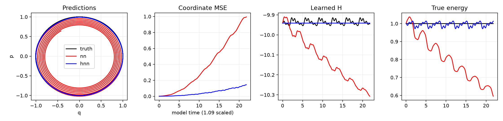
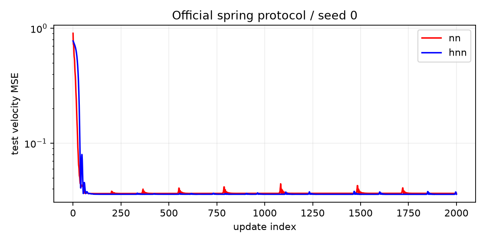

# Hamiltonian Neural Networks の調和振動子再現

2019年の **Hamiltonian Neural Networks** の最も基本的な調和振動子実験を、PyTorchで独立移植した記録である。著者公開コードの手順に準拠し、通常NNとHNNを比較した。対象は調和振動子だけであり、論文全体の再現ではない。

**表1に近い損失とエネルギー誤差を再現した。** 2019年環境や保存notebook出力の完全一致は主張しない。公開内容はコード・説明・今回生成した図・集約結果だけであり、生データ、重み、個別軌道、本文条件の補足データ、予備実験、後続研究を含まない。

論文：[Greydanus et al. (2019)](https://arxiv.org/abs/1906.01563v3) ／ [著者コード](https://github.com/greydanus/hamiltonian-nn)
固定commit：`bcc362235dc623ffe48f22ccc22417e02e9803b4`

## 結果



黒は真の系、赤は通常NN、青はHNNである。著者比較セルと同様にモデル時間を1.09倍補正している。学習Hθの保存、真Hの近似保存、数値積分の保存性は異なる。

表1と同じく、以下の**全数値を1000倍**した。単一seed0の主再現である。

| 指標 | 論文NN | 今回NN | 論文HNN | 今回HNN |
|---|---:|---:|---:|---:|
| Train loss | 37±2 | 37.104±1.914 | 37±2 | 36.947±1.913 |
| Test loss | 37±2 | 36.585±1.856 | 36±2 | 35.953±1.834 |
| Energy MSE | 170±20 | 166.364±20.376 | 0.38±0.1 | 0.453±0.072 |

train/test誤差棒は二乗誤差全成分の不偏標準偏差/√750。energy誤差棒は15損失を連続3個ずつ5群へ分け、群平均の母標準偏差/√5。seed間誤差ではなく、著者名bootstrap_confも再標本化ではない。



[集約CSV](results/table1_comparison.csv)と[集約JSON](results/official_metrics.json)を保存した。JSONには個別初期値・個別軌道・生損失列を含めていない。

## 理論とPyTorch実装

入力は正準座標x=(q,p)。通常NNはMLPの2出力を速度として直接使う。HNNは第2出力をスカラーHθとし、Hamiltonの方程式から速度を作る。

$$\widehat{\dot q}=\frac{\partial H_\theta}{\partial p},\quad
\widehat{\dot p}=-\frac{\partial H_\theta}{\partial q},\quad
L=\frac{1}{2N}\sum_i\|\hat v(x_i)-v_i\|_2^2.$$

`torch.autograd.grad(..., create_graph=True)` で入力微分にも計算グラフを残し、この速度誤差から `backward()` で重みを学習する。HNNの評価にも入力微分が必要なので速度計算を `no_grad()` で囲まない。

連続時間では∇Hθ·J∇Hθ=0だが、Hθが真Hと一致する保証や、離散積分の厳密保存を意味しない。

## データと学習

|項目|公式コード準拠の条件|
|---|---|
|真Hと速度|H=q²+p²、(2p,−2q)|
|初期分布|方向rand(2)*2−1を正規化、半径一様[.1,1]|
|データ|50軌道×30点、時間0〜3両端含む|
|生成|solve_ivp、rtol1e−10、既定RK45・atol1e−6|
|雑音|clean教師速度を先に計算し、座標だけにstd.1の雑音|
|分割|先頭25軌道750点train、残り25軌道750点test|
|MLP|2→200→200→2、hidden tanh、最終biasなし、直交重み|
|最適化|float32、full batch、Adam lr.001、weight_decay.0001|
|更新|range(total_steps+1)に従い2001回、最終モデルだけ評価|

各モデル構築直前にseed0を戻し、初期state_dict一致を確認した。各41,200パラメータ。HNNの未使用第1出力も公式通り残した。各軌道のNumPy乱数順は方向2値→半径1値→q雑音30値→p雑音30値である。テストによる調整やcheckpoint選択はない。

本文はH=(q²+p²)/2、一様初期energy[.2,1]と記し、公開コードと異なる。今回の主実行はコード規約に限定し、両者を混ぜていない。

## 著者notebookの評価順序

- 定性的rolloutは[1,0]から時間30、2000点、solve_ivp rtol1e−12。
- 比較セルでは真軌道を時間20で先に積分した後、共有t_span/t_evalをin-placeで1.09倍してモデルを積分する。
- 集約セルは変更済み時間21.8から15初期点で開始。初期値はrand(2)*1.6−.8へ.2*sign(x)を加える。
- 同じ引数が反復ごとに1.09倍されるため、モデルhorizonは最初23.762、最後約79.406となる。各100点。
- energy lossは、数値積分した真軌道とモデル軌道のq²+p²の差の二乗の時刻平均。

各セルをソース順に一回実行した数値状態を移植し、可視化用の乱数消費も維持した。固定RK4や解析解生成へ置換していない。共有引数を毎回新規生成する診断も別名の集約値として示すが、著者手順の主結果を置き換えない。

## 再実行

成功した環境はPython3.12.14、Torch2.14.0、NumPy2.3.5、SciPy1.18.1、Matplotlib3.11.1。[依存版](requirements-lock.txt)は観測した版である。今回の元実験では既存環境を使い追加インストールしなかった。

これらの依存を持つPythonで、リポジトリ直下から実行する。

```sh
OMP_NUM_THREADS=1 MKL_NUM_THREADS=1 OPENBLAS_NUM_THREADS=1 python run.py
OMP_NUM_THREADS=1 MKL_NUM_THREADS=1 OPENBLAS_NUM_THREADS=1 python report.py
```

合成データの再生成から学習・評価まで行うため、非公開データや配布checkpointを必要としない。新出力は無視対象の `runs/`、集約は `runs/summary/`。掲載済みresults/は上書きしない。生配列・重み・個別軌道は再実行時にローカル生成されるが公開版には同梱しない。HNN_RUN_DIR、HNN_REPORT_DIRで入出力先を指定できる。同名run内のファイルは再実行で更新される。

CPU1thread、学習開始時に空き10GiB以上を確認する。元実験のNN学習約5.70秒、HNN約7.43秒は毎回test評価を含むwalltimeである。

## 限界・出典

保存notebookのexecution_countには飛びがあり、著者の手動再実行回数・真の乱数状態は復元できない。今回はソース順一回という解釈。2019年のライブラリバイナリも一致していない。真Hの二次式微分だけは確認済みの数式で移植し、Torch微分で照合した。

[事前条件](docs/PROTOCOL.md)、[詳細結果](docs/RESULTS.md)、[公開範囲](docs/PACKAGING.md)、[検証](docs/VALIDATION.md)、[参照URLとSHA256](upstream_manifest.json)を保存した。

著者実装はApache-2.0。本コードは監査した仕様の独立移植で、公式配布物ではない。[LICENSE](LICENSE)と[NOTICE](NOTICE)に出典・変更を記録する。著者source、論文本文・原図は再配布していない。

```bibtex
@inproceedings{greydanus2019hamiltonian,
  title={Hamiltonian Neural Networks},
  author={Greydanus, Sam and Dzamba, Misko and Yosinski, Jason},
  booktitle={Advances in Neural Information Processing Systems},
  year={2019},
  eprint={1906.01563},
  archivePrefix={arXiv}
}
```
